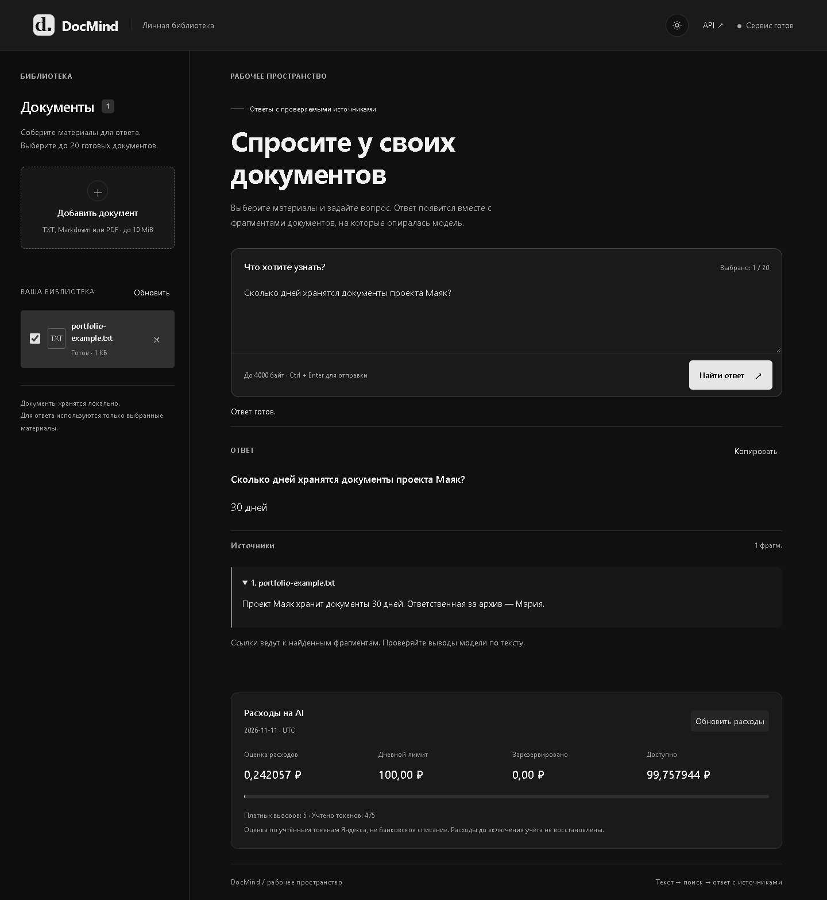

# DocMind

Локальный сервис на Go: загружаете TXT, Markdown или PDF, задаёте вопрос,
получаете ответ с фрагментами источников. Веб-интерфейс со светлой и тёмной
темой, сохранением выбора темы, плавными анимациями и раскрываемыми цитатами.

**Стек:** Go · net/http · PostgreSQL · pgvector · Docker Compose.
API сохраняет файлы и задания; worker извлекает текст и строит индекс.
Вопрос проходит через поиск по выбранным документам и модель ответа.
Фоновая обработка поддерживает повторы и восстановление после сбоя;
повторная индексация не создаёт дубликаты фрагментов.
Панель расходов показывает токены, учтённые попытки AI, оценку стоимости и резерв.
Дневной лимит — `AI_DAILY_BUDGET_RUB=100`; общий для API, worker и поиска CLI, день — UTC.

## Запуск

Нужен Docker Desktop с Linux-контейнерами. Из корня проекта в PowerShell:

```powershell
if (-not (Test-Path .env)) { Copy-Item .env.example .env }
docker compose --env-file .env -f deploy/docker-compose.yml up -d --build
```

Откройте [localhost:8080](http://localhost:8080): загрузите документ,
дождитесь статуса «Готов», выберите его и задайте вопрос.
Тема учитывает настройки системы; кнопка в шапке сохраняет ваш выбор.
Анимации отключаются при системной настройке «уменьшить движение».
Порты меняются через `API_PORT` и `POSTGRES_PORT` в `.env`.

По умолчанию `fake`: без ключей и оплаты, ответ — цитата по совпадению слов.
Для Alice AI укажите в `.env` `CHAT_PROVIDER=yandex`, `EMBEDDING_PROVIDER=yandex`,
`YANDEX_API_KEY` и `YANDEX_FOLDER_ID`. Найденные фрагменты и вопросы отправляются
Яндексу; вызовы платные. При смене embeddings нужна переиндексация.

## Пример работы

На вымышленном документе «Проект Маяк хранит документы 30 дней»:

- **Вопрос:** сколько дней хранятся документы проекта Маяк?
- **Alice AI:** 30 дней — с исходным фрагментом в источниках.

Если ответа в тексте нет, сервис сообщает о недостатке информации.



## Проверки

```powershell
node --test tests/frontend/workspace.test.js tests/frontend/usage.test.js
docker compose --env-file .env -f deploy/docker-compose.yml --profile tools run --build --rm integration
```

CI проверяет форматирование, Go vet/race, frontend, PostgreSQL и полный HTTP-сценарий
с fake-провайдерами. `/healthz` — процесс, `/readyz` — БД, `/metrics` — HTTP и AI: очередь, её возраст, сохранённые векторы, повторы, время и неизвестные вызовы.
`GET /api/v1/usage` — потребление и бюджет за текущий день UTC; fake-вызовы бесплатны.
Живой Яндекс проверен на TXT/MD/PDF: ответы с источниками, отсутствие ответа
в тексте, один сценарий внедрённой инструкции, переиндексация и перезапуск.

## Ограничения

Один пользователь, локальный запуск, без авторизации. Файл до 10 MiB;
PDF только с текстовым слоем, без OCR. Вопрос — до 4000 байт и 20 документов.
Источники проверяются сервером; выводы модели нужно сверять с текстом.
Compose `down` сохраняет данные, `down -v` удаляет. Перед обновлением
остановите API/worker и сохраните резервную копию БД.
Расходы — оценка по usage и настроенным ценам, не счёт Billing. Лимит учитывает резерв;
при неопределённом результате он сохраняется. Повторы могут оплачиваться снова.
Уменьшение лимита действует сегодня, увеличение — со следующего UTC-дня.

[API / OpenAPI](api/openapi.yaml)


## Восстановление индекса и контроль качества

Каждый успешный embedding сохраняется в PostgreSQL по хешу текста, модели и
поколению индекса. Повтор использует готовые векторы; готовый индекс публикуется
одной транзакцией. Потеря lease или удаление документа останавливает новые вызовы.
Большое задание уступает следующий временной слот после сохранённого прогресса,
не расходуя попытку ошибки. После сбоя между ответом провайдера и записью в БД
повторная оплата одного фрагмента всё ещё возможна: API не предоставляет приложению
транзакцию вместе с PostgreSQL.

Повторная загрузка одинаковых байтов одного MIME возвращает существующий документ
и не создаёт новое задание. Исторические файлы без хеша не перечитываются миграцией.
Для принудительного обновления индекса используйте команду reindex.

`EMBEDDING_REVISION` задаёт доступную ревизию (по умолчанию `latest`),
`EMBEDDING_SPACE_EPOCH` — метку контролируемой смены пространства.
Одинаковые значения нужны у API, worker и CLI. Изменение требует переиндексации;
само имя `latest` не закрепляет фактическую версию модели.

Браузерные изменяющие запросы с чужого сайта запрещены сервером;
клиенты CLI без Origin/Fetch Metadata разрешены. Это не авторизация.
Обновление требует миграций 007–009 на копии БД с проверкой резервной копии.
[Набор оценки поиска, фактов и отказов](testdata/README.md) запускается отдельно.
